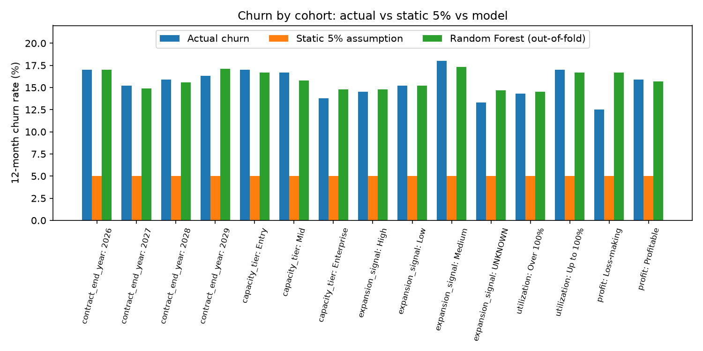
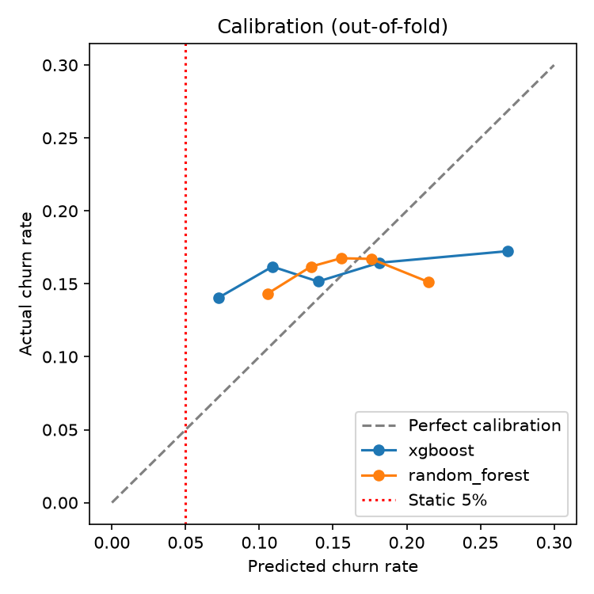

# Back-Testing Validation Report: Static 5% Churn Baseline vs ML Models

**EverPure CLV Predictive Analytics (Case Study 2)** · Varun Mandava · 11 October 2026
Code: https://github.com/SugarFreeBiskoot/everpure-clv-predictive-analytics

## 1. Summary

- **The static 5% churn assumption is about 3x too optimistic.** Actual 12-month churn was **15.82%** (298 of 1,884 arrays with a known outcome; 95% CI 14.17% to 17.47%). The 5% rule expected 94 churners; 298 happened. 5% sits 12.9 standard errors below the observed rate.
- **The bias is systematic, not limited to one segment.** The baseline under-predicts churn in all 15 cohorts tested, by 7.5 to 13.0 percentage points. In 14 of 15 cohorts the 95% CI excludes 5%; the exception is loss-making arrays, where 56 arrays are too few to tell.
- **Over 15 years the error compounds.** At 5% churn, 46.3% of arrays are still customers after 15 years; at the observed rate, 7.6%. Expected years retained fall from 10.20 to 4.92, so any 15-year net profit projection built on 5% is overstated by about **107%** (roughly 2x).
- **Both ML models beat the baseline.** Random Forest improves the Brier score by 7.4% over static 5% (0.1342 vs 0.1449) and cuts cohort bias from around -11 pp to within about +/-1.4 pp in 14 of 15 cohorts.
- **But the gain comes from correcting the level, not from personalisation.** A single constant equal to the observed churn rate scores better than either model (Brier 0.1332). A permutation test shows the features carry no detectable signal (XGBoost AUC 0.522 vs shuffled-label 95th percentile 0.528, p = 0.13).

**Recommendation:** replace the static 5% with a churn rate measured from outcomes (15.8% on this data) immediately. Use the model scores for the warehouse and monitoring pipeline, but do not use them to rank or target individual arrays until new data sources (Section 7) give the model real signal.

## 2. Data and method

| Item | Detail |
|---|---|
| Data | 2,000 arrays across 1,000 accounts (exactly 2 arrays per account) |
| Known outcomes | 1,884 arrays. The 116 arrays with no `churn_event_next_12m` label were set aside before any training and only scored at the end |
| Data quality | 862 utilization values above 100%, 58 negative profits, 116 missing labels, 111 `UNKNOWN` expansion signals. No rows dropped; treatment in README, Data Quality Log |
| Models | XGBoost (300 shallow trees) and Random Forest (500 trees, min 20 arrays per leaf) |
| Benchmarks | Static 5% (today's assumption) and a constant equal to the observed churn rate of the training folds |
| Validation | 5-fold cross-validation, stratified by churn and **grouped by account**, so both arrays of an account are always in the same fold. Every prediction in this report is out-of-fold: made by a model that never saw that account |

**Metrics**
- **Brier score**: mean of (predicted probability - outcome)^2. Lower is better. This is the main metric because CLV needs the right probability *level*, not just the right ordering.
- **Brier skill vs 5%**: 1 - Brier(model) / Brier(static 5%). The share of the baseline's error removed.
- **Log-loss**: penalises confident wrong predictions heavily.
- **AUC**: ranking only. 0.5 = coin flip. Reported as secondary.
- **Bias (pp)**: mean predicted churn minus actual churn, in percentage points. Negative = too optimistic.

## 3. Back-test 1: static 5% vs actual outcomes

| Measure | Static 5% | Actual |
|---|---|---|
| Churners among 1,884 arrays | 94.2 | 298 |
| 12-month churn rate | 5.00% | 15.82% (95% CI 14.17% to 17.47%) |
| Still a customer after 15 years | 46.3% | 7.6% |
| Expected years retained (of 15) | 10.20 | 4.92 |

Actual churn is 3.16x the assumption. Because the CLV portal adds up net profit over 15 years, the 5% assumption overstates the 15-year projection by about 107% for an array with steady yearly profit.

The 15-year figures repeat the 12-month rate every year, since only 12-month outcomes exist. Year 1 is validated by this back-test; years 2 to 15 are an extrapolation.

## 4. Bias by cohort

The data has no product column, so I built cohorts from the fields available: contract end year, capacity tier (3 equal-sized groups), expansion signal, utilization (up to vs over 100%) and profit sign.

| Cohort | Arrays | Actual churn | 95% CI | Static 5% bias (pp) | Random Forest bias (pp) |
|---|---|---|---|---|---|
| Contract end 2026 | 171 | 17.0% | 11.3% to 22.6% | -12.0 | 0.0 |
| Contract end 2027 | 684 | 15.2% | 12.5% to 17.9% | -10.2 | -0.3 |
| Contract end 2028 | 697 | 15.9% | 13.2% to 18.6% | -10.9 | -0.3 |
| Contract end 2029 | 332 | 16.3% | 12.3% to 20.2% | -11.3 | +0.8 |
| Capacity: Entry | 630 | 17.0% | 14.1% to 19.9% | -12.0 | -0.3 |
| Capacity: Mid | 623 | 16.7% | 13.8% to 19.6% | -11.7 | -0.9 |
| Capacity: Enterprise | 631 | 13.8% | 11.1% to 16.5% | -8.8 | +1.0 |
| Expansion: High | 401 | 14.5% | 11.0% to 17.9% | -9.5 | +0.3 |
| Expansion: Medium | 588 | 18.0% | 14.9% to 21.1% | -13.0 | -0.7 |
| Expansion: Low | 790 | 15.2% | 12.7% to 17.7% | -10.2 | 0.0 |
| Expansion: UNKNOWN | 105 | 13.3% | 6.8% to 19.8% | -8.3 | +1.4 |
| Utilization up to 100% | 1,072 | 17.0% | 14.7% to 19.2% | -12.0 | -0.3 |
| Utilization over 100% | 812 | 14.3% | 11.9% to 16.7% | -9.3 | +0.2 |
| Profitable | 1,828 | 15.9% | 14.2% to 17.6% | -10.9 | -0.2 |
| Loss-making | 56 | 12.5% | 3.8% to 21.2% | -7.5 | +4.2 |

**Reading the table**
- The baseline is optimistic in every cohort. Its error is driven by the wrong overall level, not by any one segment.
- Differences *between* cohorts are mostly within noise. For example, arrays over 100% utilization churned at 14.3% vs 17.0% for the rest, but the confidence intervals overlap, so I report these as directional only, not as findings.
- The Random Forest's largest miss is the loss-making cohort (+4.2 pp), which has only 56 arrays and 7 churners.

## 5. Back-test 2: ML model accuracy vs the baseline

| Model | Mean prediction | Brier | Brier skill vs 5% | Log-loss | AUC |
|---|---|---|---|---|---|
| Static 5% | 0.0500 | 0.1449 | 0.000 | 0.5170 | 0.500 |
| Constant = observed rate | 0.1582 | **0.1332** | **0.081** | **0.4366** | 0.500 |
| XGBoost | 0.1543 | 0.1370 | 0.054 | 0.4512 | 0.522 |
| Random Forest | 0.1574 | 0.1342 | 0.074 | 0.4406 | 0.509 |

Actual churn rate: 0.1582. Random Forest was chosen as the champion model because it has the lower Brier score of the two ML models.

**Calibration.** I split arrays into 5 equal groups by predicted risk and compared predicted with actual churn.

| Risk group | XGBoost predicted | Actual | Random Forest predicted | Actual |
|---|---|---|---|---|
| 1 (lowest) | 7.2% | 14.1% | 10.6% | 14.3% |
| 2 | 10.9% | 16.2% | 13.5% | 16.2% |
| 3 | 14.0% | 15.2% | 15.6% | 16.8% |
| 4 | 18.1% | 16.4% | 17.6% | 16.7% |
| 5 (highest) | 26.9% | 17.2% | 21.5% | 15.1% |

Actual churn is flat at roughly 14% to 17% whatever the model predicts. XGBoost spreads its predictions from 7% to 27%, which makes it overconfident and is why its Brier score is worse. The Random Forest's highest-risk group actually churned *less* than average.

**Permutation test.** I shuffled the churn labels 30 times, so they were pure noise, and reran the XGBoost back-test on each shuffle.

| Real XGBoost AUC | Shuffled AUC (mean) | Shuffled AUC (95th percentile) | p-value |
|---|---|---|---|
| 0.522 | 0.489 | 0.528 | 0.13 |

The real AUC is inside the range produced by random labels, so the features do not carry detectable information about which arrays will churn.

## 6. Where the improvement comes from: level vs personalisation

For any constant prediction p, Brier = ybar(1 - ybar) + (p - ybar)^2, where ybar is the actual churn rate.

- Error from using the wrong level: (0.05 - 0.1582)^2 = **0.0117**. This is exactly the gap between static 5% (0.1449) and the constant observed rate (0.1332).
- Random Forest improves on 5% by 0.0107, which is *less* than the 0.0117 available from the level fix alone. So per-array personalisation contributes about -0.001, slightly negative.

Correcting the churn level is the whole improvement. That is also the cheapest change to make in the CLV portal.

## 7. Conclusions and next steps

1. **Replace the static 5% now** with the observed rate (15.8%) and re-measure it each time a new 12-month cohort of outcomes closes.
2. **Keep the model pipeline in production** (scores, buckets and SHAP in `CLV_SCORED_OUTPUT`), because the pipeline, monitoring and back-test history are needed regardless. Treat individual scores as close to the portfolio average until the model beats the constant-rate challenger.
3. **Collect features with behavioural signal:** renewal and contract history, tenure, support tickets, utilization *trend* rather than a single snapshot, product family, and subscription status. With dates of churn or censoring, a proper survival model (Cox or Random Survival Forest) could replace the constant-yearly-rate extrapolation.

## 8. Limitations

- Only one 12-month outcome window exists, so this is a cross-sectional back-test, not a test across several past forecast dates.
- The 116 unlabelled arrays are excluded from all accuracy figures. Their average predicted churn (16.1%) is close to the labelled average, so there is no sign they differ, but it cannot be confirmed.
- `historical_15yr_net_profit_usd` may include profit earned during the outcome window. If so, it would leak information about the label. It did not affect the results here because the model found no signal in it.